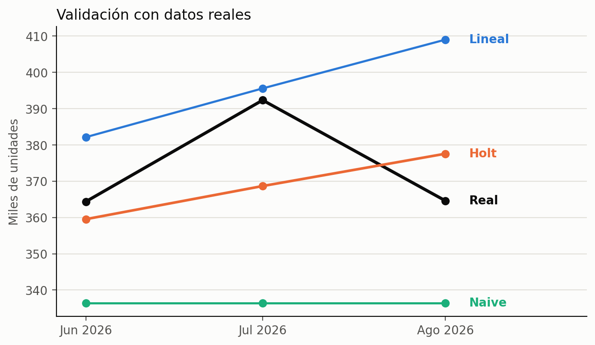
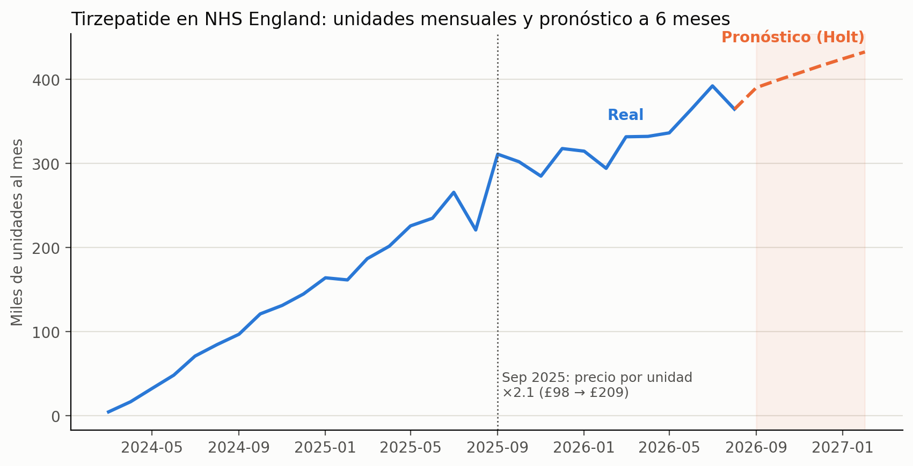

# Práctica 8 — Pronóstico (series de tiempo)

## Objetivo
Construir y comparar modelos de pronóstico para predecir nuevos datos futuros de la prescripción de **Tirzepatide** en NHS England, la sustancia que concentra el crecimiento del dataset GLP-1. Se valida primero con un corte temporal interno y después contra **datos reales que los modelos nunca vieron** (junio–agosto de 2026). El resultado se traduce a libras para conectarlo con la pregunta de negocio: cuánto revenue puede esperarse y qué tan sensible es a supuestos de precio.

## Datos usados (y por qué no son los de la Práctica 1)
Esta práctica **no usa `glp1_limpio.csv`**. Al verificar el dataset contra la fuente se detectó que le faltan filas (ver sección *Hallazgo de calidad de datos*). Por eso la serie se obtuvo con totales **calculados por la propia API** (la suma se hace en el servidor, sin paginar):

```sql
SELECT COUNT(*) AS n_filas,
       SUM(TOTAL_QUANTITY) AS unidades,
       SUM(ACTUAL_COST)    AS revenue
FROM `EPD_SNOMED_YYYYMM`
WHERE BNF_CHEMICAL_SUBSTANCE = 'Tirzepatide'   -- antes de 2025-03: CHEMICAL_SUBSTANCE_BNF_DESCR
```

- Un registro por mes, 30 meses (marzo 2024 – agosto 2026) sin huecos.
- Los meses previos a marzo de 2024 se descartan: son el arranque del lanzamiento (20 unidades en enero, 654 en febrero) y no representan el comportamiento normal de la serie.
- En marzo de 2025 las columnas numéricas vienen como texto, por lo que se convirtieron con `SAFE_CAST(... AS FLOAT64)` dentro de la consulta.
- El precio por unidad se calcula como `revenue / unidades`.

## Decisión clave: pronosticar unidades, no revenue
El revenue mezcla dos cosas: cuántas unidades se prescriben y a qué precio. El precio por unidad **se duplicó en septiembre de 2025**:

| Mes | Precio por unidad |
|---|---|
| Jun 2025 | £97.5 |
| Jul 2025 | £97.8 |
| Ago 2025 | £97.9 |
| **Sep 2025** | **£208.5** |
| Oct 2025 | £209.3 |
| Nov 2025 | £210.9 |

(≈ ×2.1; el dataset no indica la causa, solo el hecho.) Un modelo entrenado sobre revenue interpretaría ese cambio de precio como crecimiento de demanda. Por eso se **pronostican unidades** y el revenue se obtiene después con un supuesto de precio explícito y un análisis de sensibilidad.

## Metodología
- **Serie:** unidades mensuales de Tirzepatide, marzo 2024 – mayo 2026 (27 meses) para entrenar y comparar; junio–agosto 2026 reservados como validación real.
- **Split temporal** (no aleatorio, para no usar el futuro): los últimos 6 meses (dic 2025 – may 2026) son test; el resto (21 meses) es entrenamiento.
- **Modelos comparados**
  1. **Naive** — repite el último valor observado. Es la línea base: un modelo que no la supere no aporta.
  2. **Regresión lineal** sobre el tiempo (`scipy.stats.linregress`) — una sola pendiente para toda la historia.
  3. **Holt con tendencia amortiguada** (`ExponentialSmoothing(trend='add', damped_trend=True, seasonal=None)`) — actualiza nivel y pendiente con los datos recientes y frena gradualmente la tendencia.
- **Sin componente estacional:** con 30 meses no hay ni dos ciclos anuales completos, así que no se puede estimar estacionalidad de forma confiable.
- **Métricas:** MAE (error absoluto medio, en unidades) y MAPE (error porcentual medio).

## Resultados

### 1. Prueba interna (test: dic 2025 – may 2026)

| Modelo | MAE | MAPE |
|---|---|---|
| Naive | 36,206 | 11.1 % |
| Regresión lineal | 40,148 | 12.5 % |
| **Holt amortiguado** | **30,093** | **9.4 %** |

### 2. Validación con datos reales (jun – ago 2026)
Modelos reentrenados con todos los datos hasta mayo de 2026 y comparados contra lo que efectivamente ocurrió:

| Mes | Real | Naive | Lineal | Holt |
|---|---|---|---|---|
| Jun 2026 | 364,371 | 336,433 | 382,128 | 359,531 |
| Jul 2026 | 392,320 | 336,433 | 395,560 | 368,659 |
| Ago 2026 | 364,613 | 336,433 | 408,992 | 377,563 |

| Modelo | MAE | MAPE |
|---|---|---|
| Naive | 37,335 | 9.9 % |
| Regresión lineal | 21,792 | 6.0 % |
| **Holt amortiguado** | **13,817** | **3.6 %** |



**Interpretación**
- **Holt gana en ambas pruebas**, incluida la validación con datos que ningún modelo vio. Es el modelo elegido.
- **La regresión lineal es inestable entre periodos** (12.5 % en test vs 6.0 % en validación). Una recta usa la pendiente promedio de todo su entrenamiento: en el test se entrenó con el tramo de crecimiento explosivo y lo proyectó sobre meses en que el crecimiento se había frenado, pasándose de largo; en la validación su pendiente ya incluía el tramo lento y el crecimiento se reanudó, por lo que acertó más. Holt, al actualizarse con lo reciente, es más estable.
- La serie tuvo una **desaceleración marcada**: de enero a septiembre de 2025 las unidades crecieron ~90 %, mientras que de septiembre de 2025 a mayo de 2026 solo ~8 % (311 mil → 336 mil), antes de volver a acelerar en junio–julio. El amortiguamiento de Holt captura mejor ese cambio de ritmo que una recta.
- **Julio de 2026 (392 mil unidades) es un pico que ningún modelo anticipó**; el dataset no permite explicar por qué. Es la principal fuente de error de Holt en esa validación.

### 3. Pronóstico a 6 meses (sep 2026 – feb 2027)
Holt reentrenado con los 30 meses disponibles (hasta agosto de 2026). Parámetro de amortiguamiento φ = 0.977.



**Unidades → revenue (£).** Se multiplica por un precio de referencia fijo: **£218.1 por unidad**, el promedio de jun–ago 2026. Sensibilidad de ±10 % sobre ese precio:

| Mes | Unidades | Revenue base (£M) | −10 % (£M) | +10 % (£M) |
|---|---|---|---|---|
| Sep 2026 | 390,300 | 85.14 | 76.62 | 93.65 |
| Oct 2026 | 399,167 | 87.07 | 78.36 | 95.78 |
| Nov 2026 | 407,831 | 88.96 | 80.07 | 97.86 |
| Dic 2026 | 416,298 | 90.81 | 81.73 | 99.89 |
| Ene 2027 | 424,573 | 92.61 | 83.35 | 101.88 |
| Feb 2027 | 432,659 | 94.38 | 84.94 | 103.82 |

En los 6 meses el escenario base suma ≈ **£539 millones** (rango £485 – £593 millones con ±10 % de precio). Son cifras de **todo NHS England**, no de una cadena ni de un grupo de consultorios.

## Hallazgo de calidad de datos
Antes de validar el pronóstico se comparó el dataset limpio de la Práctica 1 contra totales de la API:

| Mes | Unidades en la API | % que contiene `glp1_limpio.csv` |
|---|---|---|
| Ene 2024 – Ene 2025 | — | 99 – 100 % |
| Feb 2025 | 161,629 | 66 % |
| Dic 2025 | 317,809 | 62 % |
| May 2026 | 336,433 | 66 % |

Desde febrero de 2025 al dataset le falta entre 30 % y 39 % de las filas de Tirzepatide (p. ej., dic 2025: 30,128 filas contra 48,576 reales). La causa más probable es que la extracción paginaba con `LIMIT/OFFSET` **sin `ORDER BY`**: la API corre sobre BigQuery, que no garantiza un orden estable entre páginas, de modo que algunas filas se repiten (y `drop_duplicates()` las elimina, ocultando el problema) y otras nunca se traen. Se verificó que al paginar con `ORDER BY` sobre todas las columnas la API entrega exactamente las 48,576 filas y las 317,809 unidades de diciembre de 2025.

**Efecto en esta práctica:** con la serie incompleta las unidades parecían aplanarse en ~200 mil y Holt mostraba un MAPE de 3.9 %; con la serie exacta el error del mismo modelo en el test es 9.4 %, y la desaceleración es real pero mucho más moderada. Por eso la práctica usa la serie de la API.

**Efecto en las demás prácticas:** las Prácticas 2–7 se calcularon sobre `glp1_limpio.csv`. Los totales absolutos de 2025–2026 están subestimados; las comparaciones relativas (perfiles de consultorios, segmentos, mezcla) podrían estar menos afectadas, pero **no se verificó**, por lo que se reportan con esta salvedad.

## Limitaciones
- **Serie corta (30 meses)** y sin estacionalidad estimable; el pronóstico a 6 meses ya es un horizonte largo para ese tamaño.
- **Cambio estructural en septiembre de 2025** (precio ×2.1) incluido en los datos de entrenamiento; ningún modelo lo trata de forma explícita.
- **Validación de solo 3 puntos** y con un pico (julio 2026) fuera de patrón: la ventaja de Holt es consistente en ambas pruebas pero no definitiva.
- **φ = 0.977 es cercano a 1**: el amortiguamiento es suave y el pronóstico sigue creciendo casi en línea recta (~+8 mil unidades al mes). Además, septiembre 2026 (390 mil) queda por encima de agosto (365 mil) porque el nivel del modelo está anclado al pico de julio.
- **El pronóstico de revenue supone precio constante** (£218.1). Si el precio vuelve a cambiar como en septiembre de 2025, el efecto sería mayor que el ±10 % evaluado.
- Cifras de todo NHS England, no de clientes de YZA.
- Se exploró cómo se reparte el revenue por segmento (los de la Práctica 7) a lo largo del tiempo, pero **no se reporta** porque depende de `glp1_limpio.csv`, que tiene datos faltantes desde febrero de 2025.

## Relevancia para la pregunta ancla
La Práctica 7 identificó *quiénes* crecen (segmentos de consultorios), y ese crecimiento estaba muy ligado a la adopción de Tirzepatide. Esta práctica proyecta esa sustancia a nivel NHS England: cuánto puede crecer y cuánto revenue implica, con la salvedad de que el pronóstico es agregado y no por segmento.

## Aprendizajes de método
- **Separar volumen de precio antes de modelar revenue:** el cambio de precio de septiembre de 2025 habría parecido crecimiento de demanda.
- **Validar contra una línea base y contra datos que el modelo no vio**, no solo con un split interno.
- **Verificar los datos contra la fuente antes de confiar en una tendencia:** la serie incompleta daba un error de 3.9 % que no era real.
