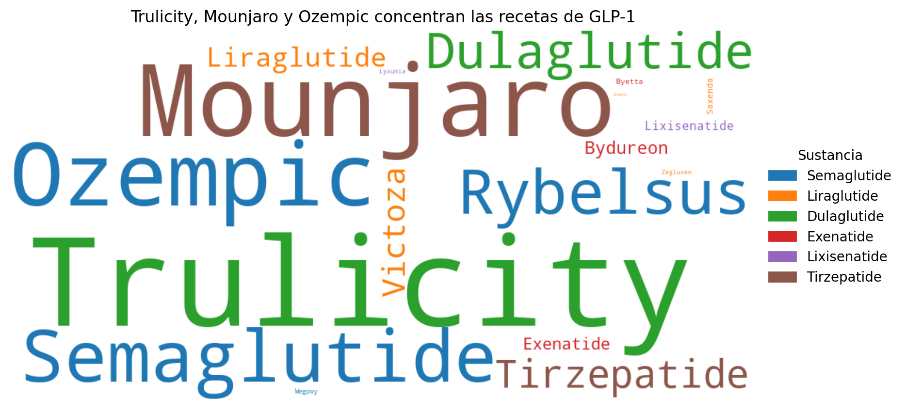
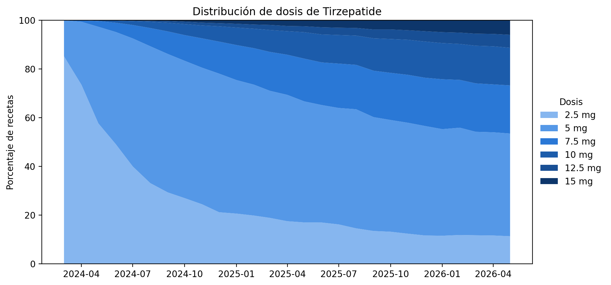
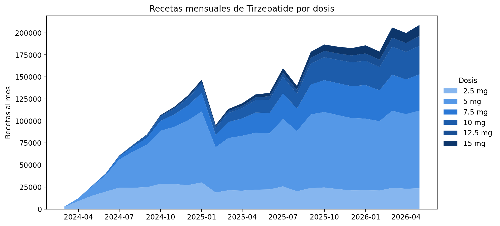

# Práctica 9 — Análisis de Texto

## Objetivo
Generar una nube de palabras y realizar un análisis exploratorio a partir del texto de las presentaciones de medicamentos GLP-1 (`PRESENTACION`), para entender qué productos y qué dosis pesan en las recetas y conectarlo con la pregunta ancla del proyecto (composición del mercado por sustancia y su evolución en el tiempo).

## Dataset base
Este análisis parte de `glp1_limpio.csv` (Práctica 1). **Limitación conocida:** al archivo le faltan filas respecto a la fuente. En el revenue de todo el GLP-1 contiene ≈ 77–88 % del total real durante 2024 y ≈ 64–72 % desde febrero de 2025 (en 2021–2022, 99 %; ver README de la Práctica 8). Por eso los volúmenes de 2024 en adelante están subestimados, y no necesariamente en la misma proporción en cada sustancia.
```python
df_final = pd.read_csv("../Práctica 1/glp1_limpio.csv", parse_dates=['FECHA'])
```

## Preparación del texto
Cada valor de `PRESENTACION` es un texto como `"Mounjaro KwikPen 5mg/0.6ml inj 2.4ml pre-filled pens"`: mezcla marca (o molécula), dosis y forma. A partir de él se crearon cuatro variables:

| Variable | Qué captura | Cómo se obtuvo |
|---|---|---|
| `PRIMERA_PALABRA` | Nombre de marca o de molécula (20 valores distintos) | Primera palabra del texto |
| `ES_COMERCIAL` | `True` si la primera palabra es distinta de la sustancia (nombre de marca) | Comparación con la columna `SUSTANCIA` |
| `FORMA` | Tableta o inyección | Si el texto contiene `tablets` |
| `DOSIS` | Dosis en mg | Número antes de `mg` (extracción por expresión regular) |

- Se conservó la forma (tableta/inyección) porque es información de contexto relevante.
- 96,167 filas quedaron sin dosis: son productos expresados en **microgramos** (Exenatide, Byetta, Lixisenatide, Lyxumia). No afectan el análisis de Tirzepatide (0 filas sin dosis); si se quisieran comparar dosis entre sustancias habría que convertir mg ↔ microgramos.

**Decisión: quedarme con la primera palabra.** En todas las presentaciones, la primera palabra es la marca o la molécula, que es justo lo que quería analizar en la nube de palabras. Por eso usé solo esa palabra y dejé fuera el resto del texto (dosis, volumen, tableta o inyección), que no me interesaba contar como palabras sueltas en la nube. La dosis y la forma sí las extraje aparte, como variables propias (`DOSIS` y `FORMA`), para otros análisis de esta práctica.

## Decisión: contar por recetas o por filas
Cada **fila** del dataset es un consultorio, en un mes, para una presentación; `ITEMS` indica cuántas recetas hay en esa fila. Se comparó el ranking por filas y por recetas (primeras palabras, ordenadas por recetas):

| Primera palabra | Filas | Recetas | Rank filas | Rank recetas | Recetas por fila |
|---|---|---|---|---|---|
| Trulicity | 989,711 | 3,857,438 | 1 | 1 | 3.90 |
| Mounjaro | 390,409 | 2,413,948 | 5 | 2 | 6.18 |
| Ozempic | 635,143 | 2,348,732 | 2 | 3 | 3.70 |
| Semaglutide | 592,111 | 1,512,120 | 3 | 4 | 2.55 |
| Rybelsus | 335,425 | 1,083,490 | 6 | 5 | 3.23 |
| Dulaglutide | 402,326 | 1,034,856 | 4 | 6 | 2.57 |

**Amplitud contra profundidad.** Las filas miden en cuántos consultorios y meses aparece un producto (amplitud), y las recetas por fila miden cuánto se receta donde aparece (profundidad). Trulicity es el primero en las dos medidas (989,711 filas y 3.86 millones de recetas). Mounjaro tiene menos filas (390,409), pero cada una trae en promedio 6.18 recetas contra 3.90 de Trulicity: se receta con mucha intensidad donde aparece, y quedó en segundo lugar por recetas aunque llegó mucho después al mercado: Trulicity aparece desde enero de 2021, el inicio del periodo, mientras que Mounjaro aparece por primera vez en noviembre de 2023 (con volumen significativo desde marzo de 2024).

**Por qué ponderé por recetas.** Elegí las recetas (`ITEMS`) porque es la medida más cercana a la actividad real de prescripción que tiene el dataset: una fila con 6 recetas pesa seis veces más que una con 1. No es una medida de personas, porque el dataset no identifica pacientes y una misma persona puede generar muchas recetas.

## Nube de palabras
La nube está ponderada por **recetas** (la comparación contra contar por filas está en la tabla de la sección anterior), con cada palabra coloreada según su sustancia (mismos colores de la Práctica 3) para que se vea qué productos son la misma molécula.



- Los tres productos más grandes (Trulicity, Mounjaro y Ozempic) concentran el **58.9 %** de las recetas.
- Sumando por molécula (recetas): Semaglutide 4,955,543 · Dulaglutide 4,892,294 · Tirzepatide 3,401,069 · Liraglutide 1,080,647 · Exenatide 255,509 · Lixisenatide 56,422.

**Qué domina.** En la nube por recetas los productos más grandes son Trulicity, Mounjaro, Ozempic y Rybelsus. Por molécula, Trulicity es Dulaglutide, Ozempic y Rybelsus son Semaglutide, y Mounjaro es Tirzepatide.

**Qué aportan los colores.** Al pintar cada palabra con el color de su sustancia, ya no veo la marca y la molécula como dos cosas distintas: Mounjaro y Tirzepatide comparten color porque son la misma molécula, y lo que pesa la molécula es la suma de las dos.

**Por qué Mounjaro y Tirzepatide aparecen separados.** Porque así están registradas las recetas: a veces se escribe la marca comercial y a veces el nombre de la molécula.

**Qué cambia entre contar por filas y por recetas.** Al pasar de filas a recetas, Mounjaro sube del lugar 5 al 2, mientras que Dulaglutide baja del 4 al 6 y Ozempic del 2 al 3. Las filas cuentan cuántos registros hay de cada producto (en cuántos consultorios y meses aparece), y las recetas cuentan cuántas se prescribieron en total. Mounjaro sube porque tiene pocas filas, pero muchas recetas en cada una.

## Nombre de marca contra nombre de molécula
Porcentaje de recetas de cada sustancia según cómo se escribió la receta:

| Sustancia | Nombre de molécula | Nombre de marca |
|---|---|---|
| Dulaglutide | 21.2 % | **78.8 %** |
| Tirzepatide | 29.0 % | 71.0 % |
| Semaglutide | 30.5 % | 69.5 % |
| Liraglutide | 41.3 % | 58.7 % |
| Exenatide | 45.5 % | 54.5 % |
| Lixisenatide | **86.5 %** | 13.5 % |

*Nota: "nombre de molécula" no equivale a "genérico": por ejemplo, para Tirzepatide solo significa que la receta se escribió con el nombre de la molécula.*

**Qué muestra la tabla.** Dulaglutide es la sustancia que más depende del nombre de marca (78.8 % de sus recetas) y Lixisenatide la que menos (13.5 %; el 86.5 % se escribió con el nombre de la molécula).

**Qué podría significar para el negocio.** Mi hipótesis es que conviene comunicar con el nombre con el que el público ya conoce el producto: hay un uso establecido, y cambiarlo de un día para otro podría causar confusión o desconfianza.

**Por qué es una hipótesis y no una conclusión.** Estos datos muestran cómo escriben las recetas los médicos del NHS en Inglaterra, no cómo conocen los nombres los clientes en México. Factores externos, como las redes sociales, pueden hacer que en México el público se familiarice más con Mounjaro que con Tirzepatide. Habría que probarlo con datos de YZA.

## Mezcla de dosis de Tirzepatide en el tiempo
Se analizó cómo cambia la proporción de recetas por dosis (2.5, 5, 7.5, 10, 12.5 y 15 mg) a partir de **marzo de 2024** (el mismo corte de la Práctica 8: antes, el producto apenas arrancaba; en enero de 2024 hay 5 recetas y en marzo, 2,827).




Últimos meses disponibles (porcentaje de recetas):

| Mes | 2.5 | 5 | 7.5 | 10 | 12.5 | 15 |
|---|---|---|---|---|---|---|
| Dic 2025 | 11.6 | 44.9 | 19.8 | 14.9 | 4.2 | 4.6 |
| May 2026 | 11.3 | 42.2 | 19.8 | 15.4 | 5.3 | 6.0 |

El volumen mensual de recetas pasó de 2,827 (marzo de 2024) a cerca de 209 mil (mayo de 2026). **La caída que se ve en febrero de 2025 en la gráfica de volumen no es real:** es el efecto de las filas faltantes del dataset (en la API, enero y febrero de 2025 tienen volúmenes casi iguales).

**Qué muestra cada gráfica.** La de porcentaje muestra qué proporción de las recetas de cada mes corresponde a cada dosis; la de volumen muestra cuántas recetas hay al mes de cada dosis.

**Qué pasa con las dosis.** En la gráfica de volumen, las recetas de 2.5 mg se mantienen más o menos en la misma cantidad a lo largo del tiempo (en la parte confiable de los datos, de mediados de 2024 a enero de 2025); por eso su peso en la gráfica de porcentaje baja: el mercado crece y las demás dosis crecen más. Las dosis altas son las que van creciendo: al inicio casi no hay recetas de 15 mg y con el tiempo van apareciendo, aunque siguen siendo una parte pequeña.

**Hipótesis de maduración del mercado.** Según la [ficha técnica del producto en el Reino Unido](https://www.medicines.org.uk/emc/product/15481/smpc), el tratamiento empieza con 2.5 mg durante 4 semanas y después sube a 5 mg; las dosis de mantenimiento son 5, 10 y 15 mg. Mi hipótesis es que, conforme el mercado madura, más pacientes pasan de la dosis de inicio a las dosis superiores. Es una hipótesis: el dataset cuenta recetas, no personas, así que no se puede seguir a un paciente en el tiempo; probarla requeriría datos por cliente, como los de YZA.

**En cuál gráfica confío más.** Confío más en la de porcentaje, porque cada mes suma 100 % y me dice cómo se distribuyen las recetas entre las dosis a lo largo del tiempo.

**El supuesto detrás de esa elección.** El porcentaje se ve menos afectado por las filas faltantes porque cada mes se lee como un todo (suma 100 %): si lo que falta se reparte de forma parecida entre todas las dosis, la proporción casi no cambia aunque el volumen total baje. Mi **supuesto** es que lo que falta es bastante uniforme entre dosis. Si faltaran más filas de unas dosis que de otras, el porcentaje también quedaría sesgado. Este supuesto **no se verificó**.

**Qué pasa con febrero de 2025.** La caída que se ve en la gráfica de volumen viene de las filas que se perdieron en la extracción (paginación sin `ORDER BY`, ver README de la Práctica 8); no es una caída real del mercado. El método de análisis (variables de texto, mezcla de dosis, porcentajes) sigue siendo válido y se puede aplicar a otra muestra de datos, pero los volúmenes desde febrero de 2025 están incompletos y, para tener cifras confiables, habría que volver a extraer los datos corrigiendo la paginación.

## Limitaciones
- **Datos incompletos.** Al dataset le faltan filas (ver README de la Práctica 8): en todo el GLP-1, desde 2024 (≈ 12–23 % del revenue) y más desde febrero de 2025 (≈ 28–36 %); en Tirzepatide, desde febrero de 2025. La pérdida no es igual en todas las sustancias, así que los rankings por recetas (la nube y la tabla de filas contra recetas) pueden estar sesgados; no verifiqué cuánto. El volumen de Mounjaro y Tirzepatide está subestimado y su crecimiento real es mayor que el que se ve. Aun así, el crecimiento es claro, y eso es lo que me llevo para el negocio: reconocer que hay crecimiento.
- **Son datos de NHS England, no de México.** Allá la gente tiene hábitos de salud y un comportamiento distintos, así que no puedo traerme los insights específicos tal cual; habría que validarlos con datos de YZA.
- **La nube cuenta recetas, no personas.** El dataset tampoco dice para qué se recetó cada producto (diabetes u obesidad), aunque estos medicamentos se usan en ambos casos. Lo que analicé es volumen de recetas, que sirve para ver qué pesa más como negocio.
- **La dosis indica la etapa del tratamiento, no a las personas.** La mayoría de las recetas son de 5 y 7.5 mg (entre 62 % y 65 % en diciembre de 2025 y mayo de 2026), y las dosis altas siguen siendo minoría. Pero como no se puede seguir a un paciente en el tiempo, no sé si quien recibe 5 mg se queda ahí o abandona el tratamiento; para eso harían falta datos por paciente.
- **Miligramos y microgramos.** Algunos productos (Exenatide, Byetta, Lixisenatide, Lyxumia) vienen en microgramos y otros en miligramos. Si más adelante comparo dosis entre sustancias, hay que convertir las unidades antes de comparar los números.

## Archivos
- `practica9.ipynb` — notebook de la práctica
- `practica_9.py` — la misma práctica como script (genera las 3 gráficas)
- `p9_nube_recetas.png` — nube de palabras ponderada por recetas
- `p9_mezcla_dosis.png`, `p9_mezcla_dosis_volumen.png` — mezcla de dosis de Tirzepatide
- Este `README.md`